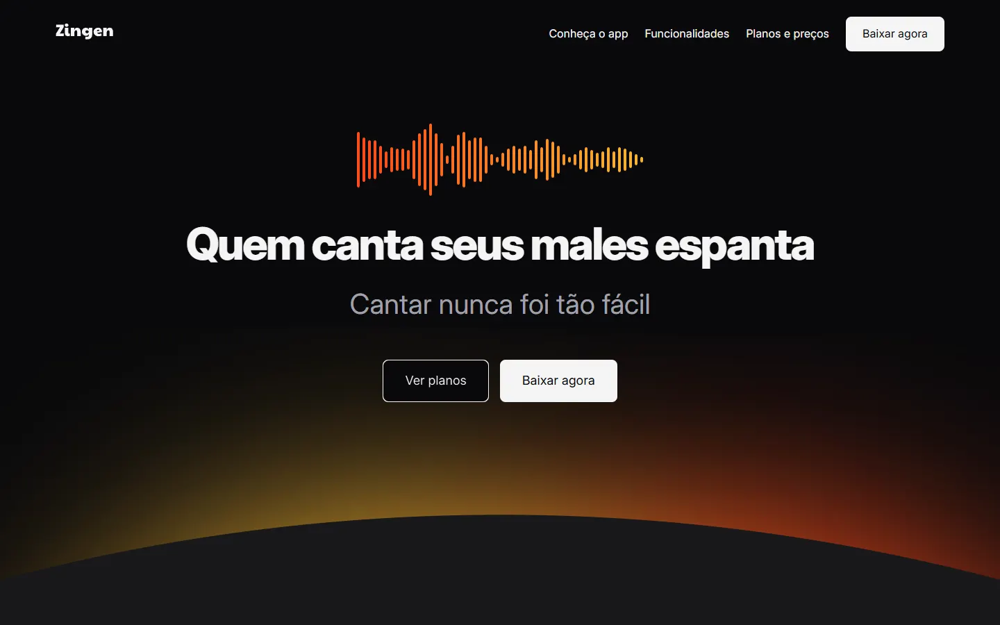
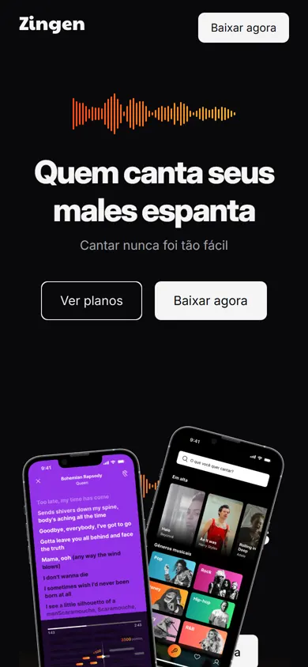

<div align="center">

# 🎤 Zingen

**Landing page responsiva de um app de karaokê**


[](https://kevinlopes23.github.io/Zingen/)

<br>

&nbsp;


</div>

## 💡 Sobre

Página de apresentação do Zingen, um app fictício de karaokê: "Quem canta seus males espanta". Projeto para praticar layout moderno com Flexbox, Grid e variáveis CSS.

## ✨ Seções

- Hero com chamadas para planos e download
- Funcionalidades: biblioteca de músicas, experiência gamificada, gravações, comunidade e letras em tempo real
- Planos Básico, Premium e Família
- Chamada para baixar o app e rodapé com redes sociais

## 🛠️ Tecnologias

HTML5 · CSS3 (Flexbox, Grid, custom properties, media queries)

## 🚀 Como rodar

Projeto estático, sem build:

```bash
git clone https://github.com/KevinLopes23/Zingen.git
cd Zingen
```

Abra o `index.html` no navegador (ou use uma extensão como Live Server).

## 👤 Autor

Feito por [Kevin Lopes](https://github.com/KevinLopes23)
